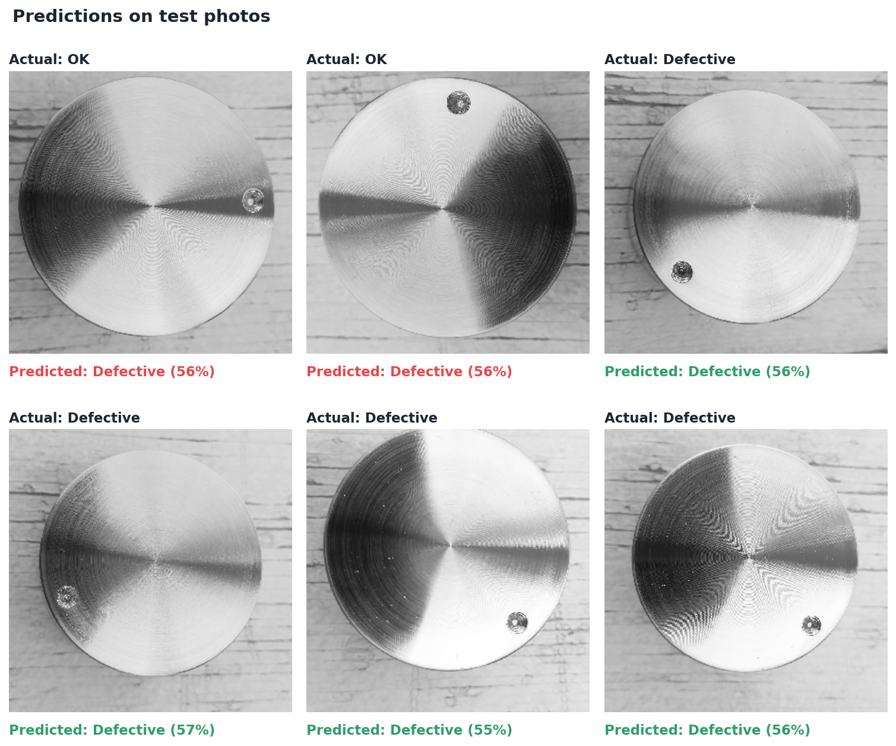
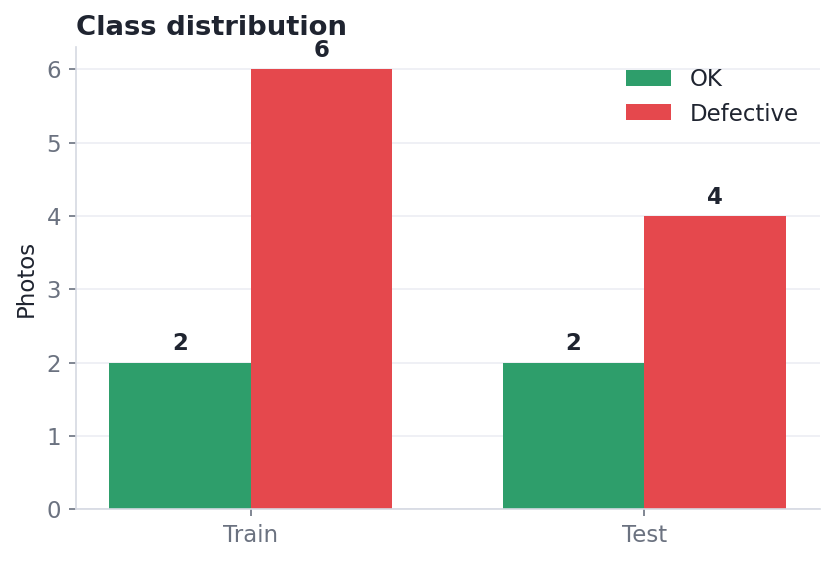
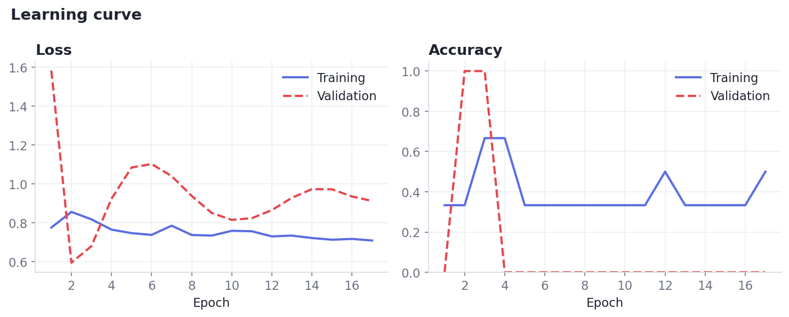
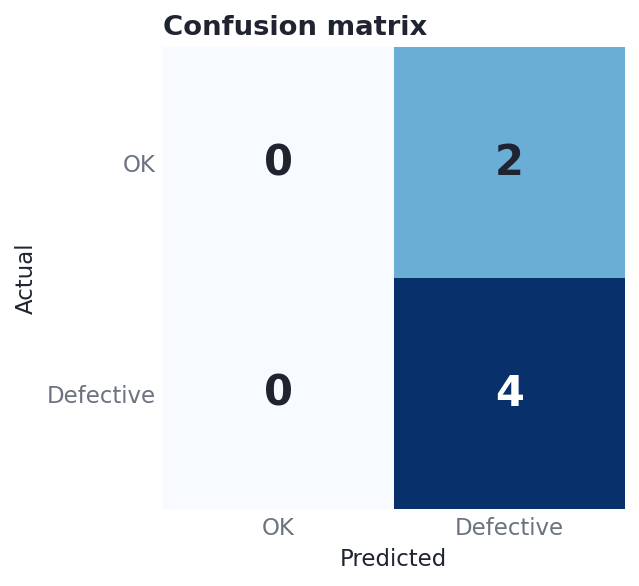
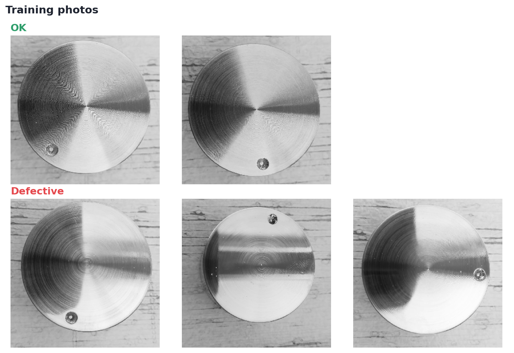

# Defect Detection using Deep Learning

A small convolutional network that looks at a photo of a round brushed-metal button and says whether it is **OK** or **defective** (a dot or a scratch on the surface). The same structure works for any "good part / bad part" photo problem: put your own photos in two folders and train.



## Read this first: the sample data is tiny

The repository contains **14 photos** (8 for training, 6 for testing), just enough to show the folder layout and to let the tests and the commands run. The original set had about 200 photos; most were removed to keep the repository small.

With 2 good photos to learn from, the network cannot learn what "good" looks like. It calls everything defective, which is what the figures above show (4 of 6 test photos right, and both OK photos wrong). That is expected with this little data, not a bug. Do not read the numbers from the sample data as the accuracy of the method.

On the original data, with photos taken under the same light (about 120 of them), the first version of this project reached roughly 92 % accuracy. Those photos are no longer in the repository, so that figure cannot be reproduced from here. To get meaningful results, train on your own photos: see [Docs/Dataset.md](Docs/Dataset.md).

## What the figures show

| Class distribution | Learning curve |
|---|---|
|  |  |

| Confusion matrix | Training photos |
|---|---|
|  |  |

All figures in [Docs/Images](Docs/Images) are written by `python main.py train`, including [the photos the model got wrong](Docs/Images/misclassified.png). When the model makes no mistakes that picture says so.

## Setup

Python 3.9 or newer. Packages go into a virtual environment inside the project, nothing global.

```bash
python3 -m venv .venv
.venv/bin/pip install -r requirements.txt
```

## Usage

```bash
.venv/bin/python main.py train                  # train, evaluate, write the figures
.venv/bin/python main.py evaluate               # score the saved model on the test photos
.venv/bin/python main.py predict photo.jpg      # one or more photos, or whole folders
```

Useful options: `--data path/to/folder` (folder that contains `train/` and `test/`), `--epochs 100`, `--threshold 0.7` (how sure the model has to be before it says "defective"), `--no-figures`, `--show` (also open the figures in windows). `--help` lists everything.

Example output of `predict`:

```
WhatsApp Image 2022-09-01 at 11.54.06.jpeg  Defective  56.6%
```

The percentage is how sure the model is about the label it gave. The model is saved as `Models/casting_cnn.keras` (not part of the repository, `train` creates it). A step by step guide with pictures: [Docs/User-Guide.pdf](Docs/User-Guide.pdf).

## How it works

- Photos are read as grayscale 300 x 300 images. A quarter of the training photos is held back for validation.
- The model rescales the pixels, randomly flips and rotates them a little while training (so a few photos go further), then has two convolution blocks, dropout and a dense layer with one sigmoid output: the probability of "defective".
- When one class has fewer photos than the other, it gets a higher weight in the loss.
- Training keeps the epoch with the lowest validation loss and stops early when it stops improving.
- Accuracy, precision, recall, F1 and the confusion matrix are computed from the test photos in plain numpy ([DefectDetection/evaluation.py](DefectDetection/evaluation.py)), so they are easy to check.

## Project layout

```
main.py                  entry point
DefectDetection/
  config.py              paths and settings
  data.py                loading and checking the photos
  model.py               the network
  training.py            training with checkpoint and early stopping
  evaluation.py          metrics
  plots.py               figures
  predictor.py           use a trained model on single photos
  cli.py                 command line
Data/                    sample photos (train/ and test/)
Tests/                   pytest
Scripts/                 version bump, user guide
Docs/                    dataset notes, figures, user guide
```

## Tests

```bash
.venv/bin/pip install -r requirements-dev.txt
.venv/bin/python -m pytest
```

They run the complete pipeline on the sample photos with a small image size: loading, training, saving, evaluation, prediction and all figures, plus the version bump. Training quality is not tested, because the sample data is too small to say anything about it.

## History

The first version was one script with hard-coded folder paths. The old commits are kept. The code was rewritten as a package: folders are checked with clear error messages, the old reshape that crashed on small test sets is gone, the model is saved in the current `.keras` format, the "misclassified" figure no longer fails when there are no mistakes, and the sample photos moved from `DefectDetection/` to `Data/`.

## Version

The version is in [version.py](version.py) and is raised by a git hook on every commit. In a fresh clone: `git config core.hooksPath .githooks`.
